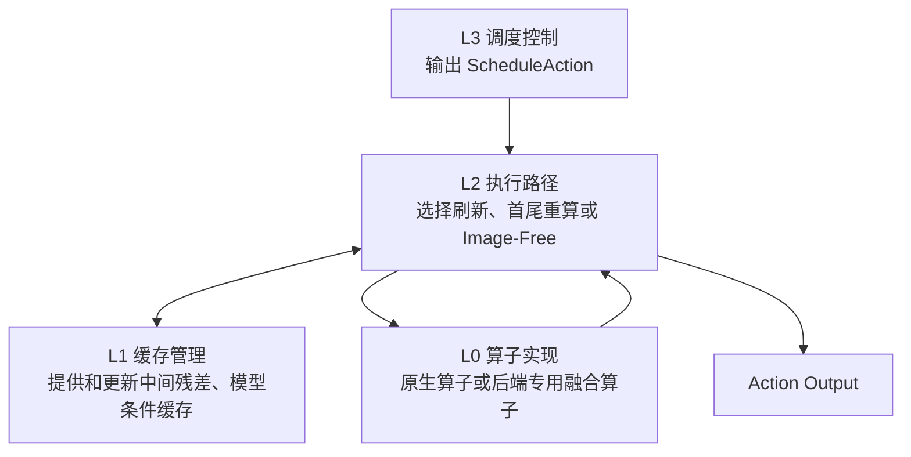

# ElegantVLA 四层执行架构

四层分别回答：选哪条路、怎样执行、复用什么、单个计算块怎样加速。
它们是代码职责的划分，不是四个独立的硬件模块。

## 实现状态

| 层级 | GR00T | OpenPI |
|---|---|---|
| L3 调度控制 | 共用五档 VLM、三档 Action Head 调度 | 共用同一套调度接口与规则 |
| L2 执行路径 | 完整刷新、首尾重算、Image-Free；可选分段 CUDA Graph 与 Action Head 编译 | 三条路径已有 PyTorch 实现，尚未接入模式专用 CUDA Graph |
| L1 缓存管理 | 中间残差、VLM 表示、条件满足时的 DiT 投影 K/V 缓存 | 中间残差、各层 prefix K/V 与去噪内部残差缓存 |
| L0 算子实现 | 可选 Triton 融合算子、Packed QKV 与静态 attention 路径 | 使用模型原有 PyTorch 算子，未移植 GR00T 专用融合算子 |

这里的“已有”指发布树包含对应代码，不等于已完成全尺寸模型验证。
OpenPI 已有 CPU 小模型 forward 测试；两个后端仍需在干净安装后验证真实权重推理、GPU 延时和闭环表现。



## L0：减少单个计算块的开销

GR00T 在模型加载时可替换以下计算块，减少 kernel 启动和中间显存读写：

| 实现 | 做法 |
|---|---|
| RMSNorm | 使用 Triton 归一化 kernel |
| Gate/Up 与 SwiGLU | 合并 gate/up 投影，并融合激活与乘法 |
| Packed QKV | 将 Q/K/V 投影组织为一次联合线性计算 |
| SigLIP FC2 + Residual | 融合线性层输出与残差相加 |
| Static Qwen Attention | 对支持的固定 batch-1 输入减少重复序列布局判断 |

源码：[realtime_eagle_kernels.py](../elegantvla/gr00t/integration/gr00t/model/modules/realtime_eagle_kernels.py)。
这些实现依赖 GR00T 的 Qwen/SigLIP 模块结构，不能直接安装到 OpenPI 的 Gemma/action expert 上。

## L1：管理可以跨帧使用的结果

共用的 [SkipController](../elegantvla/scheduling/controller.py) 记录缓存和复用预算，模型适配器决定缓存内容：

| 状态 | 保存内容 | 更新时机 |
|---|---|---|
| `_anchor_matrix` | 用于 CKA 的 probe 锚点 | 完整刷新 |
| `_backbone_middle_cache` | 中间层总残差；OpenPI 还保留完整刷新时的各层 K/V | 完整刷新 |
| `_backbone_cache` | GR00T 的 VLM 输出或 OpenPI 组装好的 prefix K/V | 完整刷新、首尾重算 |
| `_no_image_budget` | 后续无需计算图像分支的剩余次数 | 调度发放，Image-Free 消耗 |

GR00T 的 DiT 还可缓存各层投影 K/V，表示和 mask 的签名一致时复用。
该功能仅在支持的 alternate-VL DiT 路径及缓存条件满足时启用；Action Head 的去噪残差复用档位走独立路径，不叠加这一投影 K/V 缓存协议。
源码：[GR00T Action Head](../elegantvla/gr00t/integration/gr00t/model/gr00t_n1d6/gr00t_n1d6.py)、[DiT](../elegantvla/gr00t/integration/gr00t/model/modules/dit.py)。

缓存留在模型设备上，不代表所有 tensor 都是预分配的固定地址。
GR00T 的 CUDA Graph 包装器为所捕获的子图维护静态输入输出；普通路径仍有 tensor 分配，OpenPI 仍使用 `DynamicCache` 容器。
当前没有统一的固定地址 Cache Bank，也没有 `anchor_id/repr_id/layout_id` 这一套公共版本号接口。

## L2：把选择落实为计算路径

`wrapper` 根据缓存可用性与调度动作调用 `adapter`。普通判断帧只做一次 probe，其结果继续用于本次推理。
下面的 P0/P1/P2 是三条路径的说明标签，不代表三张已经整体捕获的 CUDA Graph。

| 路径 | VLM 计算 | 交给动作模块的条件 |
|---|---|---|
| P0 完整刷新 | 从 probe 继续计算全部后续层 | 当前帧完整条件 |
| P1 首尾重算 | 当前首层 + 缓存的中间残差 + 当前尾层 | GR00T 更新 VLM 表示；OpenPI 组合首尾新 K/V 与中间旧 K/V |
| P2 Image-Free | 跳过 vision encoder、probe 和 VLM | 复用最近一次条件，动作输入使用当前状态 |

GR00T 可为首层、尾层、刷新后缀以及 Action DiT 接入子图回放，并提供 Action Head 刷新/残差复用的 `torch.compile` 实现。
完整 Qwen decoder 图与首尾边界图是两种互斥粒度；首尾重算通过逐层接口执行，应使用边界图。
这不是“整个请求已经无 Python 调度、无动态分配”。

OpenPI 的 Image-Free 已跳过模型的视觉与 VLM 计算，但公共 `Policy.infer` 仍先执行输入变换和 tensor 上设备，不能宣称同时省掉了所有图像预处理与 CPU/GPU 传输。

源码：[GR00T adapter](../elegantvla/gr00t/core/adapter.py)、[GR00T Action Head 编译](../elegantvla/gr00t/core/action_head.py)、[OpenPI adapter](../elegantvla/openpi/core/adapter.py)、[OpenPI Policy](../elegantvla/openpi/core/policy.py)。

## L3：决定本帧及后续帧的计算预算

调度器读取 CKA、运动状态等观测，输出代码中的 [ScheduleAction](../elegantvla/scheduling/types.py)：

```text
ScheduleAction
  backbone_action       五档 VLM 选择
  action_head_action    三档去噪选择
```

| VLM 选择 | 执行方式 |
|---|---|
| `REFRESH` | 当前帧完整刷新 |
| `REUSE` | 当前帧首尾重算 |
| `REUSE_THEN_NO_IMAGE_1/2/3` | 当前帧首尾重算，随后发放 1/2/3 次 Image-Free 预算 |

缓存有效且预算未耗尽时，后续帧直接走 Image-Free；不能复用时回退到完整刷新。
Action Head 的三档分别是每个去噪步全算、首尾去噪步全算、仅首个去噪步全算。这里的“首尾步”与 VLM 的“首尾层”不同。

## 启用与验证

GR00T 的算子及图回放开关见 [GR00T 使用说明](../elegantvla/gr00t/README.md#optional-gpu-runtime)。
OpenPI 的算法路径与测试入口见 [OpenPI 使用说明](../elegantvla/openpi/README.md)。

端到端延时需在指定 GPU、权重、精度、batch、输入尺寸、action horizon、去噪步数和算子开关下重新测量，并注明预热次数及计时边界。
本文不将未附完整配置的历史延时作为当前发布版的性能结果。
